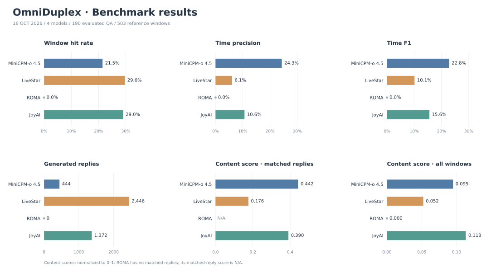
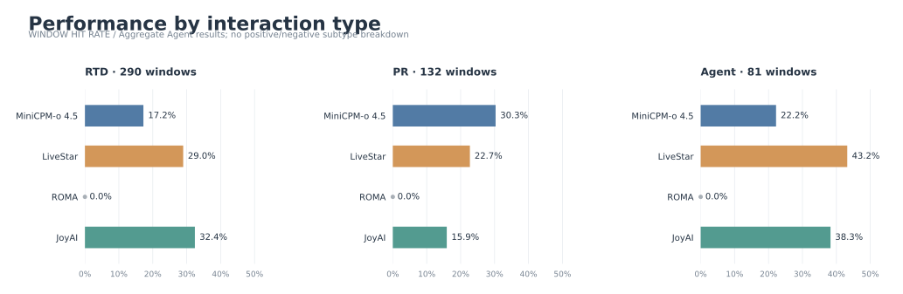
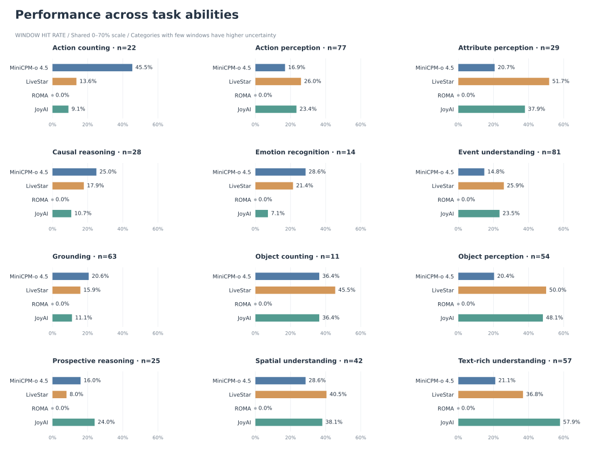

# OmniDuplex benchmark 实验结果（2026-10-16）

两轮实验的四个模型均已完成，所有 worker 正常退出，未运行 MMDuet2。合并集共 194 条 QA；4 条因 `video_103.mp4` 缺失而未评测。每个模型实际评测 **190/194 条**，共 **503 个参考回复窗口**，没有 partial 预测。

## 评分口径

使用仓库评分器对预测回复的起始时间与包含边界的参考窗口进行一对一匹配。窗口命中率为 hits/windows，时间精确率为 hits/predictions，时间 F1 是两者的调和平均。指标只衡量回复时机，不评判文本语义、工具选择或拒绝理由是否正确。Agent 正样本只评触发 agent_call 的回复；工具返回及之后的完成回复不输入模型，也不作为评分参考。

## 结果图表

图表分为总体结果、交互类型和任务能力三张，统一使用模型配色与横向柱状图。**未绘制 Agent 正/负样本子类型拆分**；交互类型中的 Agent 仍按整体结果保留。

PNG 版本：[总体结果](assets/benchmark_results_20261016.png)、[交互类型](assets/benchmark_results_20261016_interactions.png)、[任务能力](assets/benchmark_results_20261016_abilities.png)。可在仓库根目录运行 `python benchmark/docs/plot_benchmark_results_20261016.py` 重新生成。

## 总体结果

| 模型 | 命中窗口 | 窗口命中率 | 时间精确率 | 时间 F1 | 回复次数 |
| --- | ---: | ---: | ---: | ---: | ---: |
| MiniCPM-o 4.5 | 108/503 | 21.47% | 24.32% | 22.81% | 444 |
| LiveStar | 149/503 | 29.62% | 6.09% | 10.11% | 2446 |
| ROMA | 0/503 | 0.00% | 0.00% | 0.00% | 0 |
| JoyAI | 146/503 | 29.03% | 10.64% | 15.57% | 1372 |

LiveStar 的窗口命中率最高，但生成回复次数较多；MiniCPM-o 的时间精确率和 F1 最高。JoyAI 的 Agent 命中主要来自负样本窗口；这些命中不能直接解释为拒绝内容正确。

## LLM Judge 内容评分（归一化至 0–1）

使用 DeepSeek `deepseek-flash` 对已有预测进行参考标注一致性评分。原始五档分数 `0 / 0.5 / 1 / 1.5 / 2` 除以 2，映射为 `0 / 0.25 / 0.5 / 0.75 / 1`；先归一化逐条分数再求均值，与原始均分除以 2 等价。表中结果从完整精度的原始均分计算，保留四位小数。

命中回复均分只统计原时间窗口匹配成功的回复；全窗口均分将未命中窗口记零，分母为 503。4 条缺失视频的 QA 不计入评分分母。四个模型的 503 个窗口均已完成处理，失败项已重试成功，最终失败窗口数均为 0。

| 模型 | 已评分窗口 | 命中回复均分 | 全窗口均分 |
| --- | ---: | ---: | ---: |
| MiniCPM-o 4.5 | 503/503 | 0.4421 | 0.0949 |
| LiveStar | 503/503 | 0.1762 | 0.0522 |
| ROMA | 503/503 | N/A | 0.0000 |
| JoyAI | 503/503 | 0.3904 | 0.1133 |

MiniCPM-o 的命中回复均分最高；JoyAI 的全窗口均分最高。ROMA 没有匹配回复，命中回复均分为 N/A，全窗口均分为 0。内容评分基于问题、参考标注和预测文本，不重新核验原始音视频，也不按内容好坏重新选择时间匹配。

Agent 正样本的调用评分单独统计：四个模型的全窗口调用均分均为 0；本次历史推理提示词未要求结构化工具调用，缺失有效调用按原规则记零。

## 三种交互任务

下表单元格为“命中率（命中/窗口）”。RTD 有 53 条 QA，PR 有 61 条，Agent 有 76 条。

| 模型 | RTD | PR | Agent |
| --- | ---: | ---: | ---: |
| MiniCPM-o 4.5 | 17.24% (50/290) | 30.30% (40/132) | 22.22% (18/81) |
| LiveStar | 28.97% (84/290) | 22.73% (30/132) | 43.21% (35/81) |
| ROMA | 0.00% (0/290) | 0.00% (0/132) | 0.00% (0/81) |
| JoyAI | 32.41% (94/290) | 15.91% (21/132) | 38.27% (31/81) |

## Agent 子类型

| 模型 | positive（56 窗口） | missing_tool（15 窗口） | no_context（10 窗口） |
| --- | ---: | ---: | ---: |
| MiniCPM-o 4.5 | 25.00% | 13.33% | 20.00% |
| LiveStar | 30.36% | 73.33% | 70.00% |
| ROMA | 0.00% | 0.00% | 0.00% |
| JoyAI | 14.29% | 100.00% | 80.00% |

## 任务能力类别

下表为各能力类别的窗口命中率。样本少的类别不宜过度解读。

| 能力 | QA 数 | 窗口数 | MiniCPM-o | LiveStar | ROMA | JoyAI |
| --- | ---: | ---: | ---: | ---: | ---: | ---: |
| action_counting | 6 | 22 | 45.45% | 13.64% | 0.00% | 9.09% |
| action_perception | 27 | 77 | 16.88% | 25.97% | 0.00% | 23.38% |
| attribute_perception | 11 | 29 | 20.69% | 51.72% | 0.00% | 37.93% |
| causal_reasoning | 17 | 28 | 25.00% | 17.86% | 0.00% | 10.71% |
| emotion_recognition | 8 | 14 | 28.57% | 21.43% | 0.00% | 7.14% |
| event_understanding | 32 | 81 | 14.81% | 25.93% | 0.00% | 23.46% |
| grounding | 21 | 63 | 20.63% | 15.87% | 0.00% | 11.11% |
| object_counting | 6 | 11 | 36.36% | 45.45% | 0.00% | 36.36% |
| object_perception | 16 | 54 | 20.37% | 50.00% | 0.00% | 48.15% |
| prospective_reasoning | 10 | 25 | 16.00% | 8.00% | 0.00% | 24.00% |
| spatial_understanding | 12 | 42 | 28.57% | 40.48% | 0.00% | 38.10% |
| text_rich_understanding | 24 | 57 | 21.05% | 36.84% | 0.00% | 57.89% |

## ROMA 原始记录核对

ROMA 的 190 份原始记录共有 41,984 个门控判断，其中 35,065 个发生在允许回复的阶段。该阶段最高 speak probability 为 **0.97265625**，低于原配置阈值 **0.975**，没有触发生成，也没有原始文本输出。因此零命中反映本次阈值配置下的无回复行为；没有修改阈值或补算其他阈值结果。

## 可复现性与产物

两轮输入分别为前 94 条和新增索引 94–193；覆盖无重叠。核验了数据前缀、样本身份、提示词哈希及输入协议，并通过当前官方评分器复算 8 份分轮 metrics，均与保存结果完全一致。未修改原始回复或人工修正分数。

- [合并结果比较](../results/full_194_combined_20261016T002159Z/model_comparison.md)
- [复算与覆盖核验记录](../results/full_194_combined_20261016T002159Z/audit.json)
- [逐组 CSV](../results/full_194_combined_20261016T002159Z/grouped_results.csv)
- [完整 194 条合并数据](../results/full_omni_duplex_plus_groupa100_20261014T120412Z/inputs/all_qa.json)
- [MiniCPM-o 4.5 逐条预测与窗口匹配](../results/full_194_combined_20261016T002159Z/minicpmo/report.md)
- [LiveStar 逐条预测与窗口匹配](../results/full_194_combined_20261016T002159Z/livestar/report.md)
- [ROMA 逐条预测与窗口匹配](../results/full_194_combined_20261016T002159Z/roma/report.md)
- [JoyAI 逐条预测与窗口匹配](../results/full_194_combined_20261016T002159Z/joyai/report.md)

- [DeepSeek 内容评分原始比较表（0–2）](../results/judge_deepseek_flash_full_194_20261016/scores/judge_comparison.csv)
