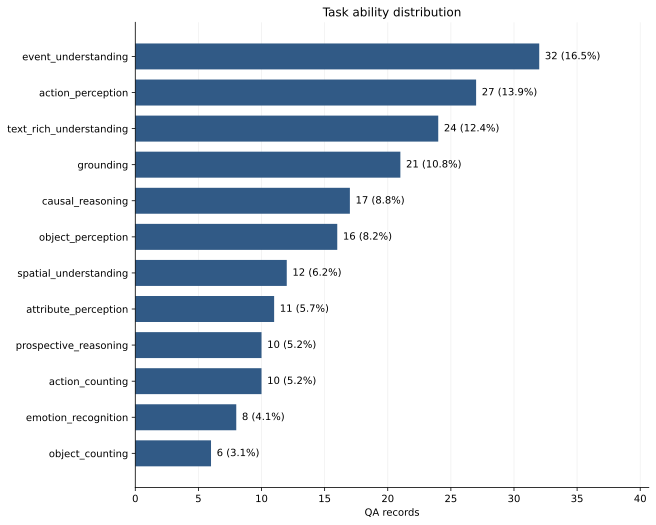
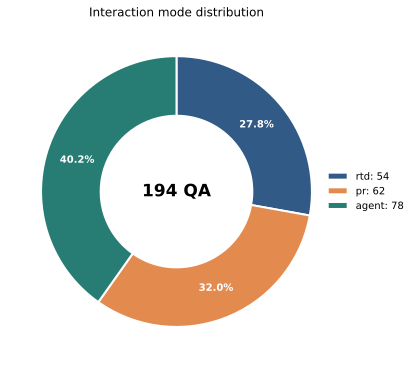
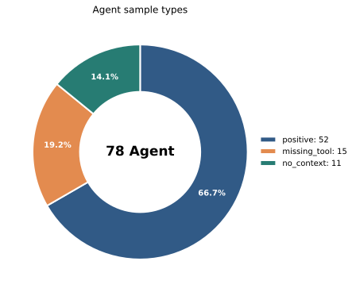
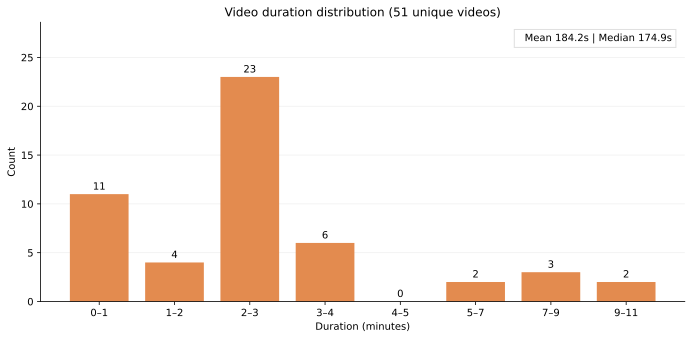
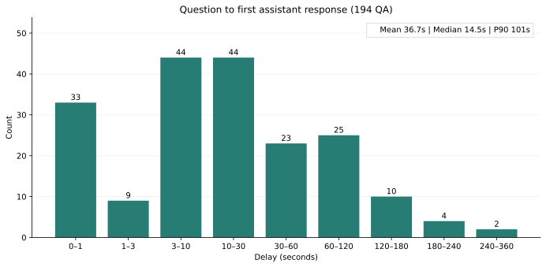
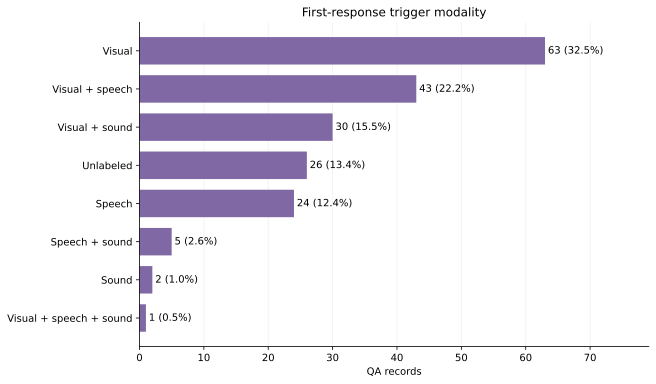

# OmniDuplex 合并数据集统计（2026-10-14）

统计对象是[完整的 194 条 QA 合并数据](../../benchmark/results/full_omni_duplex_plus_groupa100_20261014T120412Z/inputs/all_qa.json)。下列图表均以**全部 194 条**为范围；视频长度按 51 个不重复视频统计。数据来源及 SHA-256 见同目录的 `manifest.json`。

## 任务类型

| 任务 | 数量 | 任务 | 数量 |
| --- | ---: | --- | ---: |
| event_understanding | 32 | action_perception | 27 |
| text_rich_understanding | 24 | grounding | 21 |
| causal_reasoning | 17 | object_perception | 16 |
| spatial_understanding | 12 | attribute_perception | 11 |
| action_counting | 10 | prospective_reasoning | 10 |
| emotion_recognition | 8 | object_counting | 6 |

## 交互类型与 Agent 子类型

交互类型为 Agent **78 条（40.2%）**、PR **62 条（32.0%）**、RTD **54 条（27.8%）**。

78 条 Agent 数据中，`positive` 52 条，`missing_tool` 15 条，`no_context` 11 条。

## 视频长度

51 个不重复视频的平均长度为 **184.17 秒**，中位数 **174.87 秒**，范围 **12.92–599.55 秒**。长度取 `generation_context.duration_seconds`，同一视频只计一次。

## 提问到首次回复的延时

194 条 QA 的首个模型回复相对 `question_time` 的延时平均 **36.70 秒**，中位数 **14.5 秒**，P90 **101 秒**。按交互类型，RTD 的平均/中位数为 **24.81/5.5 秒**，PR 为 **49.44/26 秒**，Agent 为 **34.81/16 秒**。这里使用标注中的 `trigger_time − question_time`，**不是模型实际推理耗时**；Agent 工具返回不算模型回复。

## 首次回复的触发模态

图中把 `speech+visual` 与 `visual+speech` 等顺序不同但组成相同的标签合并。纯视觉 63 条、视觉＋语音 43 条、视觉＋声音 30 条、纯语音 24 条、语音＋声音 5 条、纯声音 2 条、视觉＋语音＋声音 1 条；另有 26 条首次回复未标注触发模态。