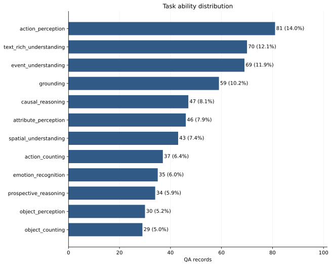
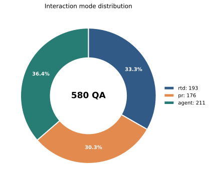
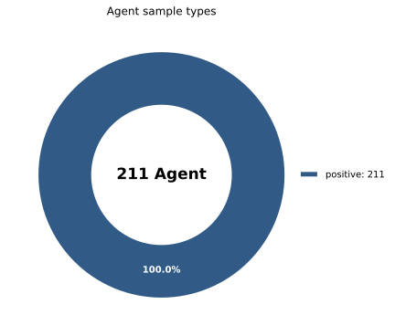
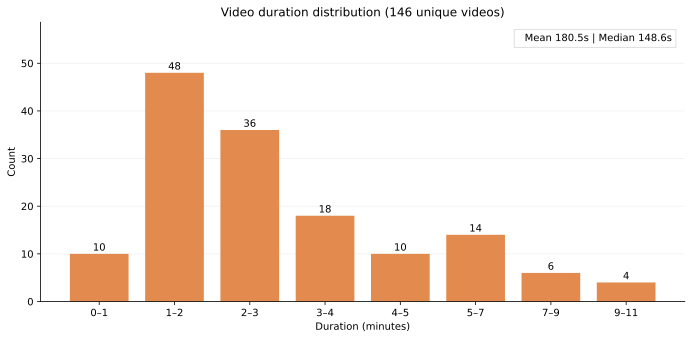
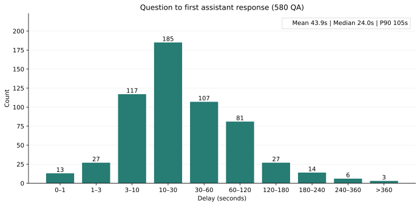
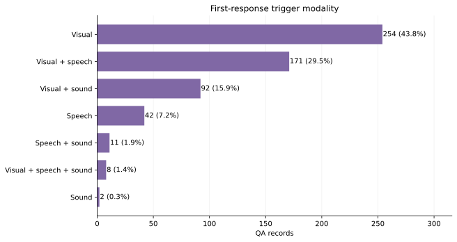

# OmniDuplex 合并数据集统计（2026-10-20）

本报告统计当前 benchmark 合并集：原 OmniDuplex 94 条 QA，加上新加入的
`GroupA_500qa_1018_all_qa.json` 合并，并在合并时自动排除所有 Agent 负样本，得到
**580 条 QA、146 个不重复视频**。旧 benchmark 的 94 条中有 14 条 Agent 负样本被滤除，
其余 80 条与 GroupA500 的 500 条均保留。此前加入的 GroupA100 已由 GroupA500 替换，
不重复计入。两份输入之间没有相同的 `video/question_time/question` 键。可复现的合并文件和来源清单位于
`benchmark/results/full_omni_duplex_plus_groupa500_20261020/inputs/`。
过滤后的合并文件 SHA-256：`3a0538ddaa0c70b354df0548094507af303850d91770e003529cfa318159d3df`。

数据来源 SHA-256：

| 输入 | 原始 QA 数 | 排除 Agent 负样本 | 纳入统计 | SHA-256 |
| --- | ---: | ---: | ---: | --- |
| 原 benchmark 输入 `full_omni_duplex_56_20261014T074459Z/inputs/all_qa.json` | 94 | 14 | 80 | `d049fa825efec29fc50266bfeb9db710a39006d04337303f7b407669e82018a5` |
| `data_generation/data/omni-duplex/GroupA_500qa_1018_all_qa.json` | 500 | 0 | 500 | `08154436487661c566fded909fc984534ca3024737e7315ec6fb50aecc3b3dc1` |

## 任务类型



| 任务 | 数量 | 任务 | 数量 |
| --- | ---: | --- | ---: |
| action_perception | 81 | text_rich_understanding | 70 |
| event_understanding | 69 | grounding | 59 |
| causal_reasoning | 47 | attribute_perception | 46 |
| spatial_understanding | 43 | action_counting | 37 |
| emotion_recognition | 35 | prospective_reasoning | 34 |
| object_perception | 30 | object_counting | 29 |

## 交互类型与 Agent 样本



| 交互类型 | 数量 | 占比 |
| --- | ---: | ---: |
| Agent | 211 | 36.4% |
| RTD | 193 | 33.3% |
| PR | 176 | 30.3% |



合并后的 211 条 Agent 数据全部为 positive；历史 `missing_tool`、`no_context` 和
`negative` 类型会在合并时过滤，不进入统计集。

## 视频长度



按每个不重复视频统计一次，视频长度平均 **180.50 秒**，中位数 **148.58 秒**，范围
**21.62–656.59 秒**。长度取 `generation_context.duration_seconds`。

## 提问到首次回复的延时



580 条 QA 的首个非工具回复相对 `question_time` 的延时平均 **43.88 秒**，中位数
**23 秒**，P90 **105 秒**，范围 **0–617 秒**。使用标注时间
`首个非工具回复.trigger_time − question_time`，不是模型实际推理耗时。按交互类型：

| 交互类型 | QA 数 | 平均延时 | 中位数 |
| --- | ---: | ---: | ---: |
| RTD | 193 | 27.82 秒 | 13 秒 |
| PR | 176 | 57.73 秒 | 35 秒 |
| Agent | 211 | 47.00 秒 | 27 秒 |

Agent 工具返回不计为模型回复。

## 首次回复的触发模态



把成分相同但顺序不同的标签合并后：纯视觉 254 条、视觉＋语音 171 条、视觉＋声音
92 条、纯语音 42 条、语音＋声音 11 条、视觉＋语音＋声音 8 条、纯声音 2 条。所有
580 条首次回复均有触发模态标注。

## 统计口径

所有任务、交互和触发模态统计均覆盖过滤后的 580 条 QA。视频长度按视频文件名去重；延时按每条
QA 最早的非工具回复计算。图表由 `plot_omni_duplex_benchmark_dataset.py` 生成；例如：

```bash
python data_generation/docs/plot_omni_duplex_benchmark_dataset.py \
  --data benchmark/results/full_omni_duplex_plus_groupa500_20261020/inputs/all_qa.json \
  --output-dir data_generation/docs/assets \
  --prefix omni_duplex_20261020_
```
