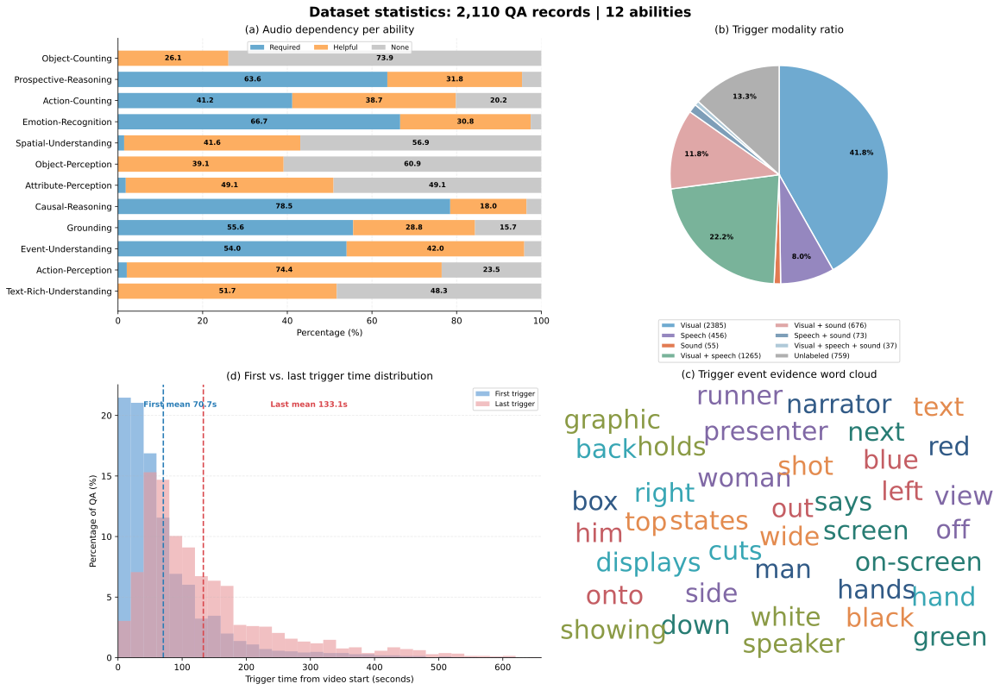

# OmniDuplex benchmark overview (2026-10-21)

This supplementary figure summarizes all **2,110 QA records** in the merged
benchmark, covering **853 unique videos**. The source is
[`all_qa.json`](../../benchmark/results/full_omni_duplex_plus_ab_gemini37_20261021/inputs/all_qa.json).



The panels use these counting rules:

- **Audio dependency:** QA-record percentages within each ability, using the
  row-level `audio_dependency` label (`required`, `helpful`, or `none`).
- **Trigger modality:** counts every non-tool response event's `trigger_type`,
  not only the first response in each QA. The 5,706 response events include 759
  with no modality label.
- **Trigger event word cloud:** words are taken from each response's evidence
  facts; if those are missing, the trigger reason is used. Common stop words are
  removed.
- **First/last trigger time:** each QA contributes its earliest and latest
  non-tool response `trigger_time`, measured from the video start. The first
  trigger mean/median is **70.7/48.0 s**; the last trigger mean/median is
  **133.1/99.0 s**. Histogram bars are percentages of QA records.

Modality event counts are visual **2,385**, visual + speech **1,265**, visual +
sound **676**, speech **456**, speech + sound **73**, sound **55**, visual +
speech + sound **37**, and unlabeled **759**.

Regenerate the other dataset charts and this overview with:

```bash
python data_generation/docs/plot_omni_duplex_benchmark_dataset.py \
  --data benchmark/results/full_omni_duplex_plus_ab_gemini37_20261021/inputs/all_qa.json \
  --output-dir data_generation/docs/assets \
  --prefix omni_duplex_20261021_
```
