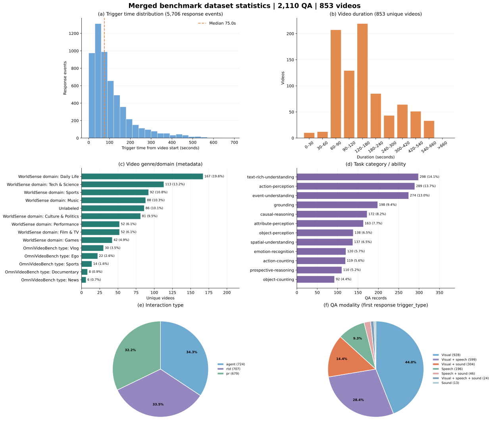

# OmniDuplex 合并 Benchmark 数据集最终报告

**统计日期：2026-10-21**  
**数据范围：2,110 条 QA，853 个唯一视频**

本报告统计合并后的完整数据集，不包含模型推理得分。原始 QA 保存在 [`all_qa.json`](../../benchmark/results/full_omni_duplex_plus_ab_gemini37_20261021/inputs/all_qa.json)，合并来源、去重情况和 SHA-256 记录在 [`manifest.json`](../../benchmark/results/full_omni_duplex_plus_ab_gemini37_20261021/inputs/manifest.json) 与 [`final_benchmark_summary.json`](../../benchmark/results/full_omni_duplex_plus_ab_gemini37_20261021/final_benchmark_summary.json)。

## 总览图

四联图分别展示每个 ability 的音频依赖比例、所有回复事件的触发模态占比、证据文本词云，以及按 QA 统计的首末触发时间。图表统计口径和生成命令见[补充说明](omni_duplex_benchmark_overview_20261021.md)。

下面这张六联图补充展示 trigger time、视频时长、视频体裁/领域、任务类别、交互类型和 QA 模态：

- Trigger time 直方图统计全部 **5,706 个非工具回复事件**的 `trigger_time`，相对视频开始时间；中位数 **75 秒**。这与上一张图按 QA 汇总最早/最晚触发时刻的口径不同。
- 视频时长对每个唯一视频只计一次，共 **853** 个视频。
- QA 模态按每条 QA 最早的非工具回复 `trigger_type` 统计，一条 QA 计一次。它表示标注的触发证据模态；`generation_context.preferred_modality` 是生成时的采样偏好，二者不是同一个字段。
- 体裁/领域使用视频元数据的显式字段：WorldSense 的 `domain`（687 个视频）和 OmniVideoBench 的 `video_type`（80 个视频）。图中保留各自分类前缀，避免将两个来源的分类体系误当成同一套标签。其余 **86** 个视频没有明确体裁标签，计为未标注；没有用数据集来源或搜索词推测体裁。

## 数据来源与合并规则

| 来源 | 纳入 QA | 来源视频数 | 说明 |
| --- | ---: | ---: | --- |
| 之前的合并 benchmark | 580 | 146 | 已包含 GroupA 500；其上游 94 条实验数据中 14 条 Agent 负样本已剔除 |
| Post-media snapshot | 30 | 6 | 原始 44 条，剔除 11 条 Agent 负样本和 3 条重复 QA |
| `AB_gemini37_1500_20261020.zip` | 1,500 | 702 | A 组 1,243 条 / 571 个视频；B 组 257 条 / 131 个视频 |
| **合计** | **2,110** | — | **853 个去重后唯一视频** |

合并键按视频名、`question_time` 和规范化问题文本识别重复项。最终数据里 Agent 负样本为 **0**；本次合并剔除了 11 条，历史来源中另剔除过 14 条。三个重复 QA 均来自 Post-media snapshot 与既有数据的重叠。`benchmark/all_qa.json` 和 GroupA40 的样本已包含在既有合并集中；GroupA100 已由 GroupA500 替代，因此都没有再次计入。

## 交互类型

| 类型 | 数量 | 占比 |
| --- | ---: | ---: |
| Agent | 724 | 34.3% |
| RTD | 707 | 33.5% |
| PR | 679 | 32.2% |

## 任务能力与交互类型分布

| Ability | RTD | PR | Agent | 合计 |
| --- | ---: | ---: | ---: | ---: |
| Action counting | 45 | 34 | 40 | 119 |
| Action perception | 96 | 88 | 105 | 289 |
| Attribute perception | 51 | 53 | 59 | 163 |
| Causal reasoning | 66 | 63 | 43 | 172 |
| Emotion recognition | 36 | 44 | 40 | 120 |
| Event understanding | 78 | 97 | 99 | 274 |
| Grounding | 74 | 56 | 68 | 198 |
| Object counting | 28 | 29 | 35 | 92 |
| Object perception | 51 | 45 | 42 | 138 |
| Prospective reasoning | 37 | 34 | 39 | 110 |
| Spatial understanding | 48 | 46 | 43 | 137 |
| Text-rich understanding | 97 | 90 | 111 | 298 |
| **合计** | **707** | **679** | **724** | **2,110** |

数量最多的是 text-rich understanding（298）和 action perception（289）；object counting（92）最少。

## 模态分布

数据中有两个不同的模态统计口径，以下分别列出，避免把首次回复和全部触发事件混为一谈。

### 每条 QA 的首次回复模态

| 首次回复模态 | QA 数量 | 占比 |
| --- | ---: | ---: |
| 纯视觉 | 928 | 44.0% |
| 视觉 + 语音 | 599 | 28.4% |
| 视觉 + 声音 | 304 | 14.4% |
| 纯语音 | 196 | 9.3% |
| 语音 + 声音 | 46 | 2.2% |
| 视觉 + 语音 + 声音 | 24 | 1.1% |
| 纯声音 | 13 | 0.6% |
| **合计** | **2,110** | **100%** |

### 所有非工具回复事件的触发模态

每个 QA 可以包含多个回复事件，因此这里的分母为 **5,706 个事件**，不是 2,110 条 QA。

| 触发模态 | 事件数 | 占比 |
| --- | ---: | ---: |
| 纯视觉 | 2,385 | 41.8% |
| 视觉 + 语音 | 1,265 | 22.2% |
| 未标注 | 759 | 13.3% |
| 视觉 + 声音 | 676 | 11.8% |
| 纯语音 | 456 | 8.0% |
| 语音 + 声音 | 73 | 1.3% |
| 纯声音 | 55 | 1.0% |
| 视觉 + 语音 + 声音 | 37 | 0.6% |

### 音频依赖

按 QA 行上的 `audio_dependency` 汇总：`helpful` 905 条（42.9%）、`required` 603 条（28.6%）、`none` 602 条（28.5%）。四联图进一步按 12 个 ability 展示各自比例。

## 视频与每视频 QA 数

唯一视频数为 **853**。视频长度按每个唯一视频只计一次：平均 **186.57 秒**，中位数 **140.56 秒**，范围 **11.72–656.59 秒**。

平均每个视频 **2.47 条 QA**，中位数为 2 条，范围为 1–14 条。分布如下：

| 每视频 QA 数 | 视频数 | 每视频 QA 数 | 视频数 |
| ---: | ---: | ---: | ---: |
| 1 | 285 | 5–6 | 58 |
| 2 | 289 | 7–8 | 16 |
| 3 | 107 | 9–10 | 9 |
| 4 | 83 | 11–14 | 6 |

## 触发时间与问题到回复延时

### 每条 QA 的首末回复触发时间

以视频开始为 0 秒，每条 QA 分别取最早和最晚的非工具回复 `trigger_time`：

| 统计 | 最早触发 | 最晚触发 |
| --- | ---: | ---: |
| 均值 | 70.66 秒 | 133.06 秒 |
| 中位数 | 48 秒 | 99 秒 |
| P90 | 154.1 秒 | 282.1 秒 |

### 问题到首次回复触发的标注间隔

按 `trigger_time − question_time` 计算；这是数据中的时间间隔，**不是模型推理延迟**。

| 交互类型 | QA 数 | 均值 | 中位数 |
| --- | ---: | ---: | ---: |
| RTD | 707 | 24.54 秒 | 13 秒 |
| PR | 679 | 52.82 秒 | 33 秒 |
| Agent | 724 | 42.72 秒 | 26 秒 |
| **整体** | **2,110** | **39.87 秒** | **22 秒** |

整体 P90 为 **89 秒**，范围为 **0–617 秒**。

## 结果文件

- 合并 QA：[all_qa.json](../../benchmark/results/full_omni_duplex_plus_ab_gemini37_20261021/inputs/all_qa.json)
- 来源与去重 manifest：[manifest.json](../../benchmark/results/full_omni_duplex_plus_ab_gemini37_20261021/inputs/manifest.json)
- 机器可读统计：[final_benchmark_summary.json](../../benchmark/results/full_omni_duplex_plus_ab_gemini37_20261021/final_benchmark_summary.json)
- 四联图矢量版：[SVG](assets/omni_duplex_20261021_omnipro_style_overview.svg)；[PNG](assets/omni_duplex_20261021_omnipro_style_overview.png)
