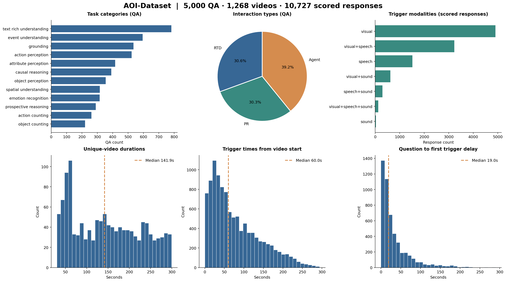

# AOI-Dataset 训练数据统计

统计时间：2026-10-24T01:26:27.630763+00:00。

数据集：[overji/AOI-Dataset](https://modelscope.cn/datasets/overji/AOI-Dataset)，视频来源全部为 FineVideo。
本次本地来源：`/remote-home/yushengliao/speech/jimodels/datasets/AOI-Dataset`。统计过程只读，不改写数据、不加载模型、不启动训练。

## 总览

| 指标 | 数值 |
|---|---:|
| QA | 5,000 |
| 唯一视频 | 1,268 |
| 平均 QA / 视频 | 3.94 |
| 平均不同任务类别 / 视频 | 2.41 |
| 原始 response 记录 | 14,805 |
| 可评分 response | 10,727 |
| 唯一视频总时长 | 51.74 小时 |
| 视频文件总大小 | 9.57 GiB |
| Agent 负样本 | 0 |

视频总时长按唯一视频计数；QA 与 response 均不是独立视频数。原始 response 包含工具结果及后续完成回复。
按当前 benchmark 的 reference_windows 口径排除 4,078 条非触发记录后，剩余 10,727 条用于后续 response 模态、触发时间、窗口及延时统计。
Agent 只计含 agent_call/task_start 的 assistant 触发回复，不将模拟工具结果或工具返回后的完成回复算作触发。



[SVG 图表](aoi_dataset_overview.svg)

## 交互类型

| 交互类型 | QA | 占比 |
|---|---:|---:|
| RTD | 1,529 | 30.58% |
| PR | 1,513 | 30.26% |
| AGENT | 1,958 | 39.16% |

## 任务类别 × 交互类型

| 任务类别 | RTD | PR | Agent | 总计 | 占比 |
|---|---:|---:|---:|---:|---:|
| action_counting | 78 | 73 | 111 | 262 | 5.24% |
| action_perception | 155 | 156 | 212 | 523 | 10.46% |
| attribute_perception | 129 | 123 | 164 | 416 | 8.32% |
| causal_reasoning | 135 | 119 | 137 | 391 | 7.82% |
| emotion_recognition | 97 | 94 | 124 | 315 | 6.30% |
| event_understanding | 189 | 187 | 219 | 595 | 11.90% |
| grounding | 159 | 169 | 207 | 535 | 10.70% |
| object_counting | 64 | 67 | 89 | 220 | 4.40% |
| object_perception | 115 | 98 | 142 | 355 | 7.10% |
| prospective_reasoning | 98 | 78 | 114 | 290 | 5.80% |
| spatial_understanding | 90 | 105 | 121 | 316 | 6.32% |
| text_rich_understanding | 220 | 244 | 318 | 782 | 15.64% |

## 触发模态：按可评分 response

| 类别 | 数量 | 占比 |
|---|---:|---:|
| visual | 4,905 | 45.73% |
| visual+speech | 3,229 | 30.10% |
| speech | 1,520 | 14.17% |
| visual+sound | 621 | 5.79% |
| speech+sound | 298 | 2.78% |
| visual+speech+sound | 125 | 1.17% |
| sound | 29 | 0.27% |

`speech` 指语言语音，`sound` 指非语言声音；组合标签表示同一触发依赖的证据模态。

## QA 模态：该 QA 全部触发模态的并集

| 类别 | 数量 | 占比 |
|---|---:|---:|
| visual | 2,033 | 40.66% |
| visual+speech | 1,643 | 32.86% |
| speech | 676 | 13.52% |
| visual+sound | 283 | 5.66% |
| visual+speech+sound | 217 | 4.34% |
| speech+sound | 134 | 2.68% |
| sound | 14 | 0.28% |

QA 采用互斥的模态并集统计；某个 QA 的不同回复可分别为 visual 与 speech，其 QA 并集会计为 visual+speech。

## 生成采样偏好 preferred_modality

| 类别 | 数量 | 占比 |
|---|---:|---:|
| audio | 3,471 | 69.42% |
| vision | 1,529 | 30.58% |

preferred_modality 是生成时的采样偏好，不等于实际 trigger_type，不能将 audio 偏好占比当成纯音频 QA 占比。

## 视觉依赖 vision_dependency

| 类别 | 数量 | 占比 |
|---|---:|---:|
| required | 3,376 | 67.52% |
| helpful | 1,393 | 27.86% |
| none | 231 | 4.62% |

## 音频依赖 audio_dependency

| 类别 | 数量 | 占比 |
|---|---:|---:|
| helpful | 1,882 | 37.64% |
| required | 1,793 | 35.86% |
| none | 1,325 | 26.50% |

## 视频时长、触发时间与交互延时

| 指标（秒） | N | 均值 | 中位数 | P90 | P95 | 最小 | 最大 |
|---|---:|---:|---:|---:|---:|---:|---:|
| 唯一视频时长 | 1,268 | 146.91 | 141.91 | 263.26 | 283.12 | 30.00 | 299.72 |
| 问题输入时间 | 5,000 | 23.23 | 0.00 | 80.00 | 120.00 | 0.00 | 251.00 |
| 首次 trigger（距视频起点） | 5,000 | 56.11 | 39.00 | 134.00 | 168.05 | 0.00 | 290.00 |
| 末次 trigger（距视频起点） | 5,000 | 86.87 | 67.00 | 189.00 | 219.00 | 0.00 | 294.00 |
| 全部 trigger（距视频起点） | 10,727 | 78.65 | 60.00 | 173.00 | 205.00 | 0.00 | 294.00 |
| question → 首次 trigger | 5,000 | 32.89 | 19.00 | 80.00 | 111.00 | 0.00 | 290.00 |
| question → 每个 trigger | 10,727 | 55.78 | 36.00 | 138.00 | 176.00 | 0.00 | 291.00 |
| 回复窗口宽度 | 10,727 | 5.01 | 4.00 | 9.00 | 12.00 | 0.00 | 165.00 |

延时指参考标注的 `trigger_time - question_time`，不是模型推理 wall time，也不是工具执行耗时；窗口宽度为 window_end − window_start。分位数采用线性插值。

## 每视频 QA 数量分布（视频为分母）

| 类别 | 数量 | 占比 |
|---|---:|---:|
| 4 | 329 | 25.95% |
| 3 | 298 | 23.50% |
| 2 | 190 | 14.98% |
| 5 | 156 | 12.30% |
| 6 | 140 | 11.04% |
| 1 | 65 | 5.13% |
| 7 | 45 | 3.55% |
| 8 | 28 | 2.21% |
| 10 | 5 | 0.39% |
| 12 | 5 | 0.39% |
| 9 | 4 | 0.32% |
| 13 | 2 | 0.16% |
| 14 | 1 | 0.08% |

## Agent 必需工具

| 类别 | 数量 | 占比 |
|---|---:|---:|
| web_search | 965 | 49.28% |
| note_write | 912 | 46.58% |
| product_search | 181 | 9.24% |
| note_search | 128 | 6.54% |
| shopping_list_update | 54 | 2.76% |
| calculator | 50 | 2.55% |
| todo_create | 39 | 1.99% |
| weather_query | 33 | 1.69% |
| calendar_query | 15 | 0.77% |
| document_search | 14 | 0.72% |
| route_query | 9 | 0.46% |
| notification_send | 8 | 0.41% |
| shopping_list_query | 8 | 0.41% |
| calendar_create | 5 | 0.26% |
| order_query | 5 | 0.26% |
| knowledge_search | 4 | 0.20% |
| itinerary_query | 3 | 0.15% |
| budget_query | 1 | 0.05% |
| history_query | 1 | 0.05% |
| meeting_draft | 1 | 0.05% |
| statistics_compute | 1 | 0.05% |

同一条 Agent QA 可要求多个工具，因此必需工具占比之和可能超过 100%。

## 当前训练配置下的时间条件覆盖

每条 QA 取最早一个可评分 response，保留从视频第 0 秒开始的完整前缀；目标发声秒同时受问题输入、证据 available_time、trigger confirmed_time、窗口和整数秒因果约束。
下表调用当前 train.first_record 逻辑，仅在内存中改变候选前缀上限做统计，没有修改训练配置。

| 前缀上限（秒） | 合格 QA | 占全部 QA | 覆盖视频 | RTD | PR | Agent |
|---|---:|---:|---:|---:|---:|---:|
| 32 | 2,190 | 43.80% | 930 | 848 | 427 | 915 |
| 64 | 3,382 | 67.64% | 1147 | 1163 | 832 | 1387 |
| 128 | 4,449 | 88.98% | 1245 | 1415 | 1234 | 1800 |
| 256 | 4,992 | 99.84% | 1267 | 1529 | 1505 | 1958 |
| 512 | 5,000 | 100.00% | 1268 | 1529 | 1513 | 1958 |

**这些是时间与媒体存在性条件下的候选数，不是编码成功数。** 尚未逐样本编码检查 `max_sequence_tokens=8192`，更长前缀仍可能超 token 上限或显存。
默认 32 秒排除原因：`{"prefix_too_long": 2810}`。默认 prepare 的 --max-samples 仍为 12，不会自动使用全部 5,000 条。

## 数据完整性检查

```json
{
  "metadata_video_count_matches": true,
  "metadata_qa_count_matches": true,
  "missing_video_files": 0,
  "extra_metadata": 0,
  "metadata_qa_count_mismatches": 0,
  "duration_mismatches": 0,
  "invalid_scored_windows": 42,
  "triggers_before_question": 0,
  "agent_negative_indices": 0,
  "out_of_video_triggers": 0
}
```

上表的列表型检查项以问题记录数量展示，完整索引在 JSON 中。窗口边界问题详见 [CSV](aoi_dataset_window_boundary_issues.csv)。
本次有 42 条可评分窗口未通过严格边界检查；其中仅窗口末尾越过视频时长且其他时序合法的有 42 条，最大越界 0.491000 秒。未修改或裁剪原始窗口。

已检查全部引用文件存在、metadata 计数、每视频 QA 数、时长一致性、可评分窗口边界及问题/触发时序。未逐个重新解码视频，未校验媒体内容哈希；未执行语义正确性或感知证据审核。
当前发布 metadata 没有视频体裁分类字段，报告不根据标题推测体裁。metadata 的 source_qa 和生成机路径属于来源记录，不是当前训练所依赖的可用路径。

## 版本与复现

- all_qa.json SHA-256：`3809db9b78f1f3cadee16cafc13b7fd0133ee17ee84e451428ac87f376014d30`
- video_metadata.json SHA-256：`82a5e21b30641be1b3dccf68a28d1981a7eed86cb508a24bffdac609eaf75826`
- 完整数值：[aoi_dataset_statistics.json](aoi_dataset_statistics.json)
- 逐视频统计：[aoi_dataset_video_statistics.csv](aoi_dataset_video_statistics.csv)

在仓库根目录执行；--plots 仅需要现有 matplotlib，不加载模型：

```bash
python train/scripts/dataset_statistics.py --plots
# 自定义下载目录：
python train/scripts/dataset_statistics.py --dataset-dir /path/to/AOI-Dataset --output-dir train/docs --plots
```
