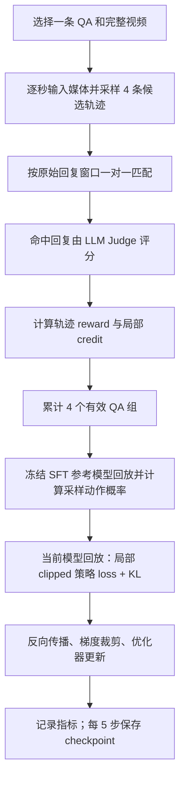

# 细粒度 GRPO：训练过程与普通 GRPO 的区别

本文描述 OmniDuplex 当前的 MiniCPM-o-4.5 流式强化学习实现，以及它与仓库中普通 GRPO 消融的关系。内容依据代码和截至 **2026-11-17** 的实验记录整理。这里的“细粒度 GRPO”是本项目的局部 credit 与单元聚合方案，不代表标准 GRPO 的唯一实现。

## 1. 研究问题

模型持续接收视频和场景音频，并根据用户请求决定何时等待、何时回复，以及 Agent 任务中是否发起委托。一次任务可能有多个参考回复窗口。我们希望模型既能在窗口内及时开口，也能避免窗口外误报和漏掉后续更新。

一整段视频的轨迹可能同时包含正确回复、错误回复和正确等待。如果只给整条轨迹一个优势值，轨迹总体得分高时，其中的误报也可能收到正向更新。细粒度方案将轨迹拆成**回复、窗口内等待、窗口外等待和控制动作**，给不同单元分配各自的训练信号。

需要区分三个层次：

1. **轨迹总 reward**：汇总一条候选轨迹的时间、质量和等待表现，用于日志及普通 GRPO 消融。
2. **局部 credit / advantage**：当前细粒度方案中，每次回复、漏答窗口或等待单元的带符号信号。
3. **策略 loss 聚合**：将单元中的采样动作转换为 clipped 策略目标，再按照单元、候选和 QA 批次聚合。

## 2. 一次训练更新的完整流程

### 2.1 输入和 rollout

本次实验从全量数据 SFT 的 MiniCPM-o-4.5 最终 checkpoint 开始。每条 QA 在对应视频上生成完整候选轨迹：每秒先输入该秒的音视频，再生成回复或等待动作；问题按数据中指定的时间插入。模型不会在生成时看到参考窗口、参考答案或未来媒体。

Agent 使用文本协议 `回复内容<|task_start|>委托指令`。标签用于解释输出，不把参考调用结果插入模型上下文。一次回复可以跨秒，代码用原生动作和回复 ID 将它的采样 token 归属到同一回复单元；强制插入而非采样的 token 不作为策略动作。

每个 QA 采样 **4 条候选轨迹**。当前 4 张训练卡按候选并行：同一 QA 的候选分散在不同 rank 上；不是每张卡同时独立处理一个 QA。每 4 个有效 QA 组累计一次优化，完整批次共 **16 条候选轨迹**。尾批、跳过或失败可能改变实际数量。

### 2.2 时间匹配

候选轨迹完成后，按回复起始时间与参考窗口进行一对一匹配，窗口两端包含。每个回复和参考窗口最多匹配一次：

- **TP**：一个回复命中一个窗口。
- **FP**：回复未匹配窗口，包括多余回复及不能解析的开口尝试。
- **FN**：一个窗口没有匹配回复。
- **正确等待**：问题后、参考窗口外的可等待决策中，模型选择等待。

这里的 TP 先表示**时间匹配**，不等于内容正确。代码入口为 [timing.py](../../benchmark/src/evaluation/timing.py)。

### 2.3 LLM Judge

当前正式实验使用本地 **Qwen3.8-27B**。对时间命中的回复：

- PR / RTD：评估面向用户的回复内容。
- Agent：分别评估回复内容和委托指令；非空回复与合法调用检查也会影响分数。

单项分数为 `0 / 0.5 / 1 / 1.5 / 2`，除以 2 后转成 0–1 的质量分。Agent 的质量分是回复与调用两项归一化分数的平均。Judge 有缓存、超时和重试；失败的候选组不会静默当成零分训练。

窗口外 FP 和漏答 FN 不靠 Judge 判断，主要使用上述时间匹配规则。Judge 依据文本与参考进行评分，不能独立证明视频事实。实现和提示分别见 [judge.py](../src/infrastructure/judge.py) 与 [judge.txt](../../benchmark/configs/prompts/judge.txt)。

## 3. 轨迹总 reward

当前实验 `tp=1.0`、`fp=1.0`、`fn=1.0`、`tn=0.1`、`invalid_call_penalty=0.1`。设参考窗口数为 \(N\)，每个命中回复的质量分为 \(q_i\in[0,1]\)，无效调用数为 \(I\)，窗口外可等待决策数为 \(S\)，其中实际正确等待次数为 \(W\)，日志中的总 reward 为：

\[
R=\frac{\sum_{i\in TP}(2q_i-1)}{N}
  -\frac{FP}{N}-\frac{FN}{N}-0.1\frac{I}{N}
  +0.1\frac{W}{S}.
\]

当 \(S=0\) 时等待项为 0。质量分 1、0.5、0 分别对应命中回复的基础 credit +1、0、-1。FP 和 FN 按参考窗口数归一化，但不会再按模型生成次数归一化：额外 FP 会持续增加惩罚。无效调用惩罚针对尝试调用但格式无效的情况。

窗口外等待的贡献总上限为 0.1，并非每秒加 0.1。具体可等待范围还要求进入该秒时处于空闲状态且存在采样动作；续说时刻不属于同一等待分母。最终以 [local_reward.py](../src/domain/local_reward.py) 的单元归属和计算为准。

**示例。** 一条 QA 有两个窗口，模型有一次满分 TP、一次 FP、漏掉一个窗口，窗口外正确等待比例为 90%，且无无效调用，则 `R=0.5−0.5−0.5+0.09=−0.41`。这个总分是轨迹统计结果；当前局部更新不会把 `−0.41` 统一分给所有动作。

## 4. 局部 credit 如何分配

当前选择 `grpo_advantage_mode=local`。各单元使用**零基准**局部信号，不对四个候选轨迹的局部分数再做组内标准化。

| 单元 | 局部 advantage | 聚合权重和归因 |
|---|---:|---|
| 命中窗口的回复 | `2q−1` | `1/N`；该回复的采样动作在单元内平均 |
| 未命中的回复或空开口 | `−1` | `1/N`；每次额外回复独立计入 |
| 尝试了不合法调用的回复 | 在上述回复 credit 上再减 `0.1` | 格式惩罚和该回复绑定 |
| 已命中窗口内的等待 | `0` | 保留结构覆盖，不把此前等待视为漏答 |
| 未命中窗口内的等待 | `−1` | `1/N`；先在该窗口的可归属等待时刻内平均 |
| 漏答窗口被回复占满 | 将 `−1` 按窗口占用比例分给相关回复 | 与该回复已有 credit 相加，不重复计算 |
| 窗口外正确等待 | `+1` | 整个等待单元权重为 `0.1 × W/S` |
| 其他采样控制动作 | `0` | 局部方案不给独立奖励 |

如果漏答窗口中既没有可归属等待动作、也没有可归属回复，FN 仍计入轨迹统计，但该 FN 没有对应的局部梯度，并记录为 `local_unassigned_fn`。问题之前的动作不参与局部 credit。

### 一个混合轨迹示例

假设有两个参考窗口，模型先在窗口外误答一次，然后在第一个窗口正确回复，第二个窗口保持沉默：

| 动作 | 局部 advantage | 对应权重 |
|---|---:|---:|
| 窗口外误答 | -1 | 1/2 |
| 第一个窗口的满分回复 | +1 | 1/2 |
| 第二个窗口内的等待 | -1 | 1/2 |
| 其余窗口外正确等待 | +1 | 整体不超过 0.1 |

因此，同一轨迹既可以抑制误答，也可以强化正确回复和适当等待。FP 的负向系数会在回复的采样 token 间分摊，当前**没有把整项惩罚单独集中到首次开口 token**；这是否使误触发惩罚不足，需要进一步的梯度分析和实验，而不能仅凭代码断言。

## 5. 优势值和策略 loss

对于一个采样动作，定义当前策略与生成轨迹时策略的概率比：

\[
\rho_t(\theta)=\exp\left(\log\pi_\theta(a_t|h_t)-\log\pi_{\rm old}(a_t|h_t)\right).
\]

对于分配到该动作的 advantage \(A_t\)，使用 PPO 风格的裁剪项：

\[
\ell_t=-\min\!\left(\rho_t A_t,\;\operatorname{clip}(\rho_t,1-\epsilon,1+\epsilon)A_t\right),\quad \epsilon=0.2.
\]

实现中正、负系数分开处理，使裁剪方向与 advantage 符号一致。回复动作先在回复内平均；漏答等待先在每个决策和窗口内平均；窗口外等待按其独立权重聚合。各单元求和，再在候选轨迹和有效 QA 组上平均。相同动作可能属于多个适用单元，其贡献可以叠加。

完整批次每个 QA 的 4 条候选先平均，再对 4 个 QA 平均。DeepSpeed 的梯度累计缩放在 [grpo_judged.py](../src/training/grpo_judged.py) 中配平；尾批使用实际 QA 数，零权重 padding 仅用于完成累计边界。对应实现见 [local_policy.py](../src/models/local_policy.py)。

## 6. 与普通 GRPO 的关键区别

普通 GRPO 消融沿用相同总 reward，对同一 QA 的 4 条候选轨迹计算：

\[
A_i^{\rm group}=\frac{R_i-\operatorname{mean}(R)}{\operatorname{std}(R)+10^{-4}}.
\]

实现采用总体标准差；如果组内 reward 标准差不超过 `1e-8`，这一组会因缺少组相对信号而跳过。普通 baseline 配置使用 `group_relative + token_mean`：轨迹中的有效采样动作共享轨迹 advantage，并按 token 平均。

| 对比项 | 普通 GRPO baseline | 当前细粒度方案 |
|---|---|---|
| 原始评分 | 每条轨迹计算 TP、FP、FN、等待和质量总分 | 同样记录总分，并保留逐单元 credit |
| advantage | 同组轨迹总 reward 标准化，每条轨迹一个值 | 回复、漏答窗口和等待分别使用零基准局部值 |
| 误答与正确回复混在一条轨迹 | 共享正或负 advantage | 可对正确回复给正信号、对误答给负信号 |
| 四条轨迹总分相同 | 组相对 advantage 为 0，组会跳过 | 只要存在非零局部信号仍可更新 |
| 默认聚合 | 所有有效采样 token 平均 | 回复/窗口/等待单元分别加权聚合 |
| 长回复影响 | token 更多时可能占更大比例 | 回复内先平均，单条回复不因 token 数直接线性增权 |

例如，某条轨迹有一个满分 TP 和一个 FP，它的总 reward 比无 FP 轨迹低，但如果仍高于组均值，普通 GRPO 给这条轨迹的 advantage 仍可能为正；其中 FP 的动作也会共享这一正值。细粒度方案分别给 TP 和 FP 正、负 credit。具体参数更新仍受共享参数、裁剪和 KL 等影响，不能保证所有场景下行为都会立即按预期改变。

### 四组消融

| 实验 | advantage | loss 聚合 |
|---|---|---|
| 普通 GRPO | `group_relative` | `token_mean` |
| 仅局部 advantage | `local` | `token_mean` |
| 仅修改聚合 | `group_relative` | `unit_weighted` |
| 完整细粒度方案 | `local` | `unit_weighted` |

`local + token_mean` 分支不应用 `unit.weight`，因此等待和事件归一化行为与完整方案不同；它是刻意保留 token 平均效应的消融，不应误称为只改变一个 loss 数值。完整说明和配置见 [grpo_ablations.md](grpo_ablations.md)。

## 7. KL 约束

当前实验使用 **β=0.03**，冻结参考为训练起点的同一全量 SFT checkpoint。对采样动作定义

\[
\delta_t=\log\pi_{\rm ref}(a_t|h_t)-\log\pi_\theta(a_t|h_t),\qquad
k_t=e^{\delta_t}-1-\delta_t.
\]

实现使用非负的采样 K3 形式。回复先按回复单元平均，等待/控制按时刻聚合；两类都存在时各占一半。问题前动作不参与。它是 rollout 动作上的代理估计，**不是完整词表精确 KL**；在策略更新和采样分布不完全一致时也不应简单当作精确 KL。

\[
L=L_{\rm local\ clipped}+\beta L_{\rm sampled\ KL}.
\]

参考模型冻结，在训练卡上回放后卸载到 CPU；KL 不参与轨迹 reward。日志的 `kl_surrogate` 未乘 β，`kl_contribution` 已乘 β。同权重起点的非零代理值还可能包括回放和数值差异，不能全部解释为训练漂移。实现见 [reference_kl.py](../src/models/reference_kl.py)。

## 8. 已运行实验和参数

当前带 Judge 的完整细粒度训练从相同的全量 SFT 起点开始，使用 [120 条训练 QA 和 24 条验证 QA](../prepared/grpo_kl003_120qa_20261115/manifest.json)，训练 QA 中 Agent、PR、RTD 各 40 条。验证集与训练集视频不重叠。

| 参数 | 值 |
|---|---|
| 训练 / Judge GPU | 0–3 / 7 |
| 候选数 / QA 梯度累计 | 4 / 4 |
| 学习率 / weight decay | `1e-6` / `0.01` |
| PPO clip / KL β | `0.2` / `0.03` |
| FP / FN / TN 权重 | `1.0` / `1.0` / `0.1` |
| 最大序列长度 | `65536` tokens |
| 视频范围 | 完整视频；超预算和失败情况按程序规则处理 |
| 激活卸载上限 | 每个训练进程 160 GiB CPU 预算 |
| 优化器 / 精度 | DeepSpeed ZeRO-2，CPU 优化器卸载，BF16 |
| 上限 / 保存 | 40 optimizer steps；每 5 步保存 |

配置为最多 2 个 epoch，但该实验在 40 步上限停止；不能称为完整跑完两轮。训练发生过两次中断：一次远端直接保存失败后从 step 10 恢复，一次迁移空间错误后从已保存的 step 16 恢复。最终 **step 40 checkpoint 已完成并迁移到 `~/jidata`**，原 `/data` 路径保留链接。恢复时重新加载了优化器和随机状态；运行级统计跨进程重新计数，分析时需合并日志并避免重复步骤。

普通 GRPO 消融采用相同 SFT 起点、数据、Judge、奖励权重和 β，改变为 `group_relative + token_mean`，以分离优势分配与聚合的组合效果；截至本文记录时该消融仍在训练。

## 9. 当前证据与解释边界

### 训练轨迹上的历史比较

以下比较取两轮**前 30 个共同训练步**，对应 QA 顺序中的 120 个位置一致，逐步汇总各候选轨迹 TP、FP、FN 后计算微平均。旧 GRPO-30 使用 `fp=0.5` 且命中直接给内容满分；新 GRPO-40 使用 `fp=1.0` 和 LLM Judge。两者都使用局部 credit、单元加权和 β=0.03。

| 训练轨迹 | Precision | Recall | F1 | 平均 TP / FP（每条候选轨迹） |
|---|---:|---:|---:|---:|
| 旧 GRPO-30 | 35.28% | 54.69% | 42.89% | 1.094 / 2.006 |
| 新 GRPO-40，前 30 步 | 50.36% | 50.52% | 50.44% | 1.010 / 0.996 |

这些是训练采样轨迹的时间匹配指标，不是固定测试集上的 checkpoint 性能。新一轮的 FP 惩罚和 Judge 同时改变，不能将差异单独归因于其中一个因素。每步采样和参数变化不同，也不能把单步 reward 的升降直接当成模型性能趋势。

### AOI-Bench 阶段性结果

截至 **2026-11-17 02:00 UTC**，GRPO-40 的 AOI-Bench 只完成 59 / 1,941 条；在基座、SFT 和 GRPO-40 共同完成的这 59 条上，时间 F1 分别为 20.22%、42.16%、53.58%。这是小样本、尚未经过内容 Judge 的中间结果，不应作为最终效果或论文结论。[实时配对报告](../../benchmark/results/grpo_local_judge_fp1_kl003_step40_aoi_20261116/comparison_live.md)会随评测更新。

## 10. 监控和代码索引

- [grpo_judged.py](../src/training/grpo_judged.py)：采样批次、Judge 流水线、回放、累计更新与 checkpoint。
- [local_reward.py](../src/domain/local_reward.py)：窗口匹配后分配 TP/FP/FN/等待的局部 credit。
- [local_policy.py](../src/models/local_policy.py)：局部或组相对 advantage 的两种聚合。
- [reference_kl.py](../src/models/reference_kl.py)：冻结参考回放及采样 KL。
- [grpo_gradient_monitor.py](../src/infrastructure/grpo_gradient_monitor.py)：策略项和加权 KL 对**采样动作对数概率**的梯度范数及方向；它不是完整参数空间梯度比。
- `trajectories.rank*.jsonl`：保存候选、事件、reward 和局部归因；`metrics.rank*.jsonl`：保存每步训练指标。TensorBoard 目录由训练输出中的 `tensorboard_run.json` 记录。
- [当前实验说明](grpo_training_current.md)和[四组消融配置](grpo_ablations.md)提供更简短的运行配置与历史方案。
